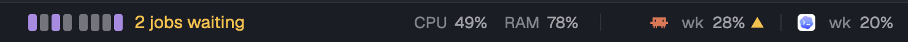

# Herdr mods

Mods for [Herdr](https://herdr.dev), the desktop app for terminals and coding agents. Made for a setup
where several coding agents work at once, with self-hosted build machines beside them.

| Mod | What it does |
| --- | --- |
| [Agent quota](quota/) | Claude, Codex and other agents' usage limits in the status bar, plus live CPU, RAM and GPU load (`system`). |
| [Runners](runners/) | What waits for your self-hosted runners and build machines, what runs on them and each machine's load: a status-bar chip, a side panel and a timeline. |
| [Your stats](stats/) | Your own delivery numbers in a side panel: PRs merged, time to merge, AI share (Claude vs Codex), per-repo breakdown. |
| [Path menu](path-menu/) | Right-click a terminal to open the files and folders on screen. |
| [Controls](controls/) | One menu to turn any status-bar block and any side-panel button off and on. |



## Install

Ask the agent running in Herdr: "add the Herdr mod at github.com/Lakris2407/herdr-mods/tree/main/runners"
(or `quota`, `stats`, `path-menu`, `controls`). Herdr's guide tells it to read every file first and to
say what the mod runs.

By hand: clone this repo, do the [one-time setup](#one-time-setup), then copy the mods you want and
add their blocks as each mod's README says.

```sh
git clone https://github.com/Lakris2407/herdr-mods
cd herdr-mods
./sync.sh runners controls   # or ./sync.sh for every mod
```

`sync.sh` copies each folder's `mods/` into `~/.config/herdr-app/mods` (or `$HERDR_APP_HOME`) and runs
`herdr-app check` on each mod. It never touches your layout or `keys.json`.

Mods are trusted code: they run programs such as `gh`, `ssh` and `quota-axi`. Each README lists what
its mod runs. Read it before you install.

## One-time setup

Herdr's own layouts and mods are read-only, so the mods go into a copy of each.

1. Clone the layout (this switches to the clone) and the tab bar:

   ```sh
   herdr-app do layout.clone '{"name":"main","as":"main-plus"}'
   herdr-app do mod.clone '{"name":"tabs","as":"tabs-plus"}'
   ```

2. In `~/.config/herdr-app/layouts/main-plus.json`, use `tabs-plus` for the `tabs` block.
3. Replace the status block

   ```json
   { "id": "status", "type": "block", "content": { "mod": "workspace-status" }, "size": { "px": 28 } }
   ```

   with a row. Each mod's README gives the block to add to `children`:

   ```json
   { "id": "status", "type": "row", "size": { "px": 28 }, "resizable": false, "children": [
     { "id": "status-main", "type": "block", "content": { "mod": "workspace-status" }, "size": { "weight": 1.9 }, "min": 160 }
   ] }
   ```

   Use weights, not fixed pixels, for the status blocks: then every block gets a share at any window
   width, and each one draws less when it gets less room. Weigh them by what each needs: a block
   whose share is smaller than its narrowest view is clipped, and a large share left empty is wasted.

   Order the row by urgency, not by mod: what needs you on the left (the space's branch and agents,
   CI, the runners chip), machine telemetry on the right (system, then quota). Give `status-main` a
   `min` that fits the branch name, about 160. The weights in each README (runners 2.8, system 2.0,
   quota 2.4) keep the window labels on the quota before the system graphs, which say less.
4. Side panels go into the `panel-body` stack, beside Files and Changes. Give each one a button in
   `~/.config/herdr-app/mods/tabs-plus/main.js`: add its id to the enabled panels and a
   `panelButton(...)` beside the others. To hide buttons from the Controls menu, use
   [controls/tabs-plus.md](controls/tabs-plus.md) instead.

## Development

Edit a mod here, run `./sync.sh <folder>`, and Herdr reloads it. Tests: `npm test` (Node 22 or
newer); they run each mod's data code in plain Node, with an in-memory `herdr` stub where it needs one.

Each folder is one mod as herdr.dev lists it: `mods/<name>/`, a `RECIPE.md` (the brief another agent
builds the mod from), a `preview.png`, and a `keys.json` if it needs keys.

## License

MIT, see [LICENSE](LICENSE). `path-menu` is a modified copy of Herdr's `menu` mod and stays under
Apache-2.0, see [path-menu/LICENSE](path-menu/LICENSE).
