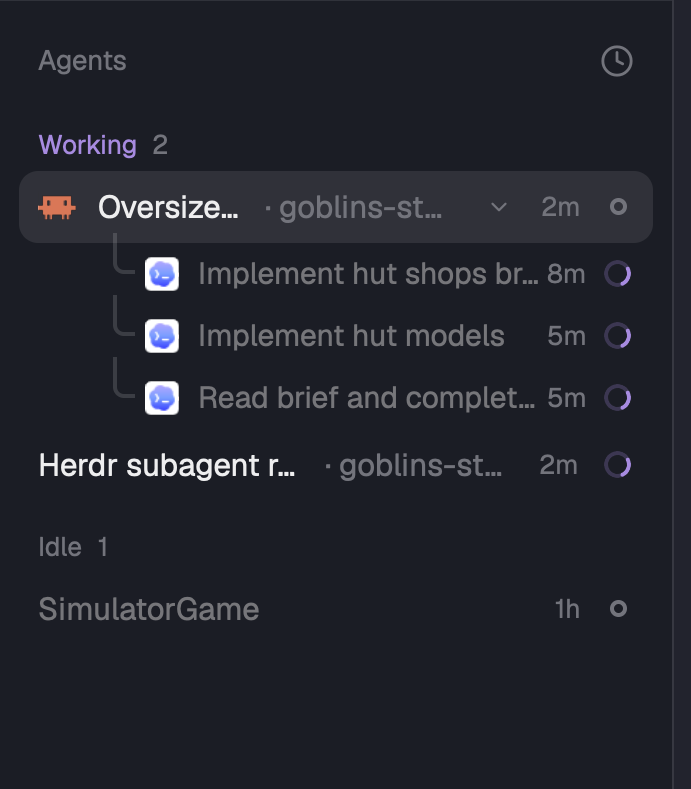

# Agents list for Herdr

A changed copy of Herdr's own Agents sidebar (`agents`), for a setup where agents start other agents.

- **Sub-agents say what they do.** A terminal an agent started with `hc run` shows its own title, the
  task, as a top-level row does. Codex's trailing ` | <folder>` is cut. Without a useful title it
  shows the `name` label (`hc label <t> name=hut-models`), then the program. Herdr's list shows
  "Codex", "Codex", "Codex".
- **Right-click a sub-agent to stop it.** The menu also peeks at it or opens it as a tab. Herdr's
  list has no way to end a sub-agent without its pane. If it still works or waits for you, Herdr asks
  first. Stopping one also stops its own sub-agents.
- **Sub-agents show how long they have run** (`7m`, `2h`), dim, before their status.
- **The task comes first.** In the priority view a row reads "task · space". The task takes the free
  width; the space is a short hint, and goes when the task already starts with it.
- **Readable quiet text.** Hints and counts are lifted to 4.5:1 on the selected row, using
  [shared/colors.js](../shared/colors.js). "Working" takes the accent color, so it no longer shares
  amber with a job that waits.
- When every agent runs the same program, the rows drop the program icon.

With [spaces-plus](../docs/outside-mods.md#spaces-plus), the space hint uses its short names
("Dinfirmaadresse 18:39" for a worktree space). Without it, the hint is Herdr's space name.

## Install

Ask the agent running in Herdr: "add the Herdr mod at github.com/Lakris2407/herdr-mods/tree/main/agents".
Or by hand, after the [one-time setup](../README.md#one-time-setup):

1. Run `./sync.sh agents`. It copies `mods/agents-plus` to `~/.config/herdr-app/mods/agents-plus` and
   runs `herdr-app check` on it.
2. In `~/.config/herdr-app/layouts/main-plus.json`, use `agents-plus` for the `agents` block.

## What it runs

Nothing. It reads Herdr's agents, terminals, panes and spaces, and runs Herdr's own commands (focus a
pane, peek at a sub-agent, pin an agent, open or stop a sub-agent).

## License

Herdr's mods are under the [Apache License 2.0](LICENSE). This folder is a changed copy of
`defaults/mods/agents/main.js` from [herdrdev/herdr-app](https://github.com/herdrdev/herdr-app)
0.1.13, so it stays under that license, not this repo's MIT license. The changes are the ones listed
above.
