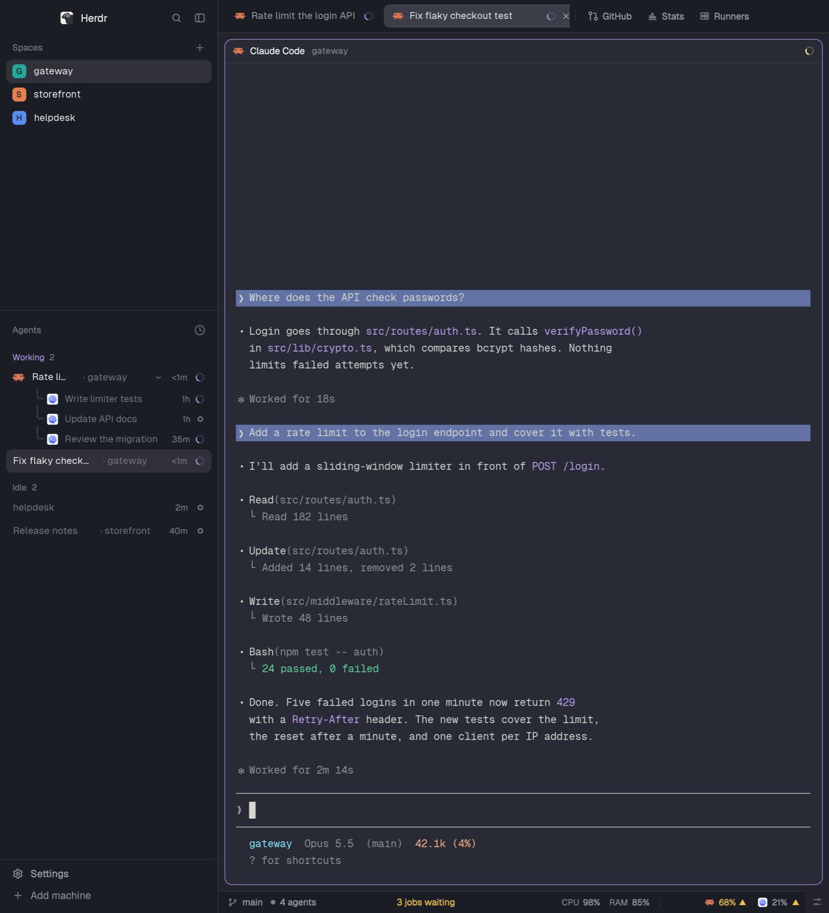

# Fleet layout for Herdr

The whole window this repo's mods were made for: several coding agents at once, with self-hosted build
machines beside them. [RECIPE.md](RECIPE.md) says what you see and how to build it.

- **Sidebar:** spaces with short names, then the [Agents list](../agents/) (sub-agents with their task
  and run time; right-click one to stop it).
- **Status bar:** the space and branch, CI, [Runners](../runners/), CPU, RAM and GPU load, [agent
  quota](../quota/), and the [Controls](../controls/) menu.
- **Side panel:** Files (with image previews), Changes, GitHub, [Your stats](../stats/) and Runners.
- **Right-click a terminal** to open the files and folders on screen ([Path menu](../path-menu/)).

## Install

Ask the agent running in Herdr: "add the Herdr layout at github.com/Lakris2407/herdr-mods/tree/main/layout".
Herdr's guide has it read every file first and say what each mod runs. Your own layout stays as it was;
`ctrl-shift-l` switches back.

By hand: `./sync.sh layout` from a clone of this repo, then `herdr-app do layout.switch '{"name":"fleet"}'`.
It replaces any `-plus` mods of the same name you already have, and keeps a `fleet.json` you already have.

**Add-on:** the GitHub panel and the CI block in the status bar use the GitHub panel mod by obrunogonzaga
([herdr.dev/mods](https://herdr.dev/mods), folder `github-panel` in
[obrunogonzaga/herdr-mods](https://github.com/obrunogonzaga/herdr-mods)). It is not in this folder: add it
first, or remove the `github` and `status-ci` nodes from `layouts/fleet.json`.

## What it runs

`gh` (stats, runners, quota), `ssh` to the build machines you list in `runners.json` (runners),
`quota-axi` (quota), and Herdr's own commands. Each mod's README has the details. Nothing runs that the
mods' READMEs don't list.

## Work on it

The mods from this repo are copies. Change them in their own folders, then run `./bundle-layout.sh`;
`npm test` fails until the copies match. The other `-plus` clones of Herdr's mods live only here.

## License

The `-plus` mods and `path-menu` are changed copies of Herdr's own mods
([herdrdev/herdr-app](https://github.com/herdrdev/herdr-app)), so they stay under the
[Apache License 2.0](LICENSE). The other mods are this repo's, under its MIT license.
