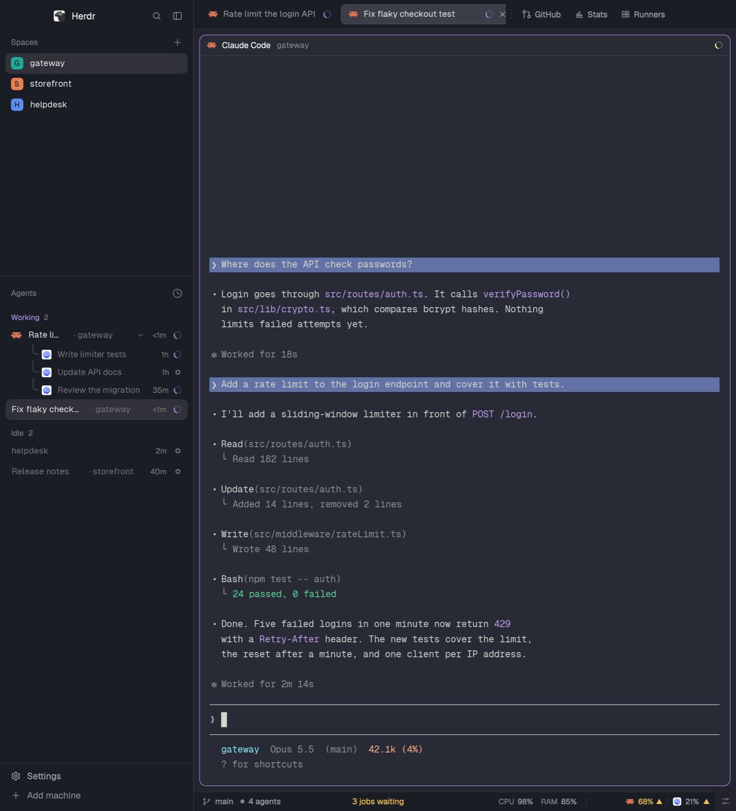

# Fleet

Fleet is a Herdr window for watching several coding agents and the build machines they use. Spaces and a task-first agent list sit on the left, framed terminals fill the middle, and one optional panel opens on the right. Tabs stay above the work; branch, agent attention, CI, runners, machine load and provider limits share a slim bottom bar.



## What you see

- A 268px sidebar on the left, on the theme's chrome surface. The 46px brand row has the Herdr mark, search and a sidebar toggle. The brand row and tab strip are window drag regions.
- Below the brand, Spaces and Agents share the remaining list area at weights 1:2, each with a 90px minimum. Each list scrolls independently. A 69px footer contains Settings and Add machine in 28px rows.
- Spaces has a 31px heading and a plus button. Normal rows are 30px high; linked worktrees are 28px high and indented under their checkout. An 18px rounded avatar carries the first letter. Names use 13px text; branch and ahead/behind hints use 11.5px.
- Avatar colors are teal #22a99a, orange #e3814f, blue #5b8def, violet #8b7cf6, green #3fae6a and pink #d9649a. Letters use white or #15161c, whichever has more contrast. Generated worktrees inherit their repository's first space color once.
- Timestamp-only space names become the repository name, with a time such as “18:39” to distinguish worktrees; older dates include day and month. The original name remains in a tooltip. Ordinary spaces keep their names. Routine main/master branches and repeated repository names disappear from the hint.
- Agents has a 41px heading with a sort button. Groups have 30px headings; parent rows are 30px, sub-agent rows 26px. The task gets the free width, followed by a short space hint, optional remote machine, elapsed time and status. Child rows have tree lines and 12.5px task text.
- A 42px tab strip spans the work area. Tabs are 29px high, rounded 7px, with 12.8px text and names capped at 170px. The active tab has a raised fill, border and close button. The new-tab plus follows the last tab inside the scrolling strip; a 1px divider separates the panel buttons.
- The panel buttons read Files, Changes, GitHub, Stats and Runners, in that order. They are 26px high with 14px icons and 12px labels.
- The terminal area has 8px outside padding and 8px gaps. Panes have a 10px corner radius, 1px border and 1px accent focus edge. Even a lone pane keeps its frame and always-visible 30px top header. Terminal padding is 14px vertically and 12px horizontally.
- Pane headers use 12px text: program icon and name, a short folder name, then status. Hover reveals split-right, split-down, zoom and close icons. Full folders remain in tooltips; generated folder names borrow their space label.
- The right panel starts hidden. When open it is 368px wide, with bounds of 280–900px. Its stack starts on Files and shows one child at a time. Files, Stats and Runners use a 42px heading, 10px panel radius and 1px border.
- Files shows 28px rows, folders first, with 18px indentation per level and A/M/D/U Git marks. A selected text file replaces the tree with a read-only, 12px syntax preview. A local image replaces it with a fitted picture and Expand / Open ↗ controls.
- Stats leads with a 30px count of this week's merged PRs, pace in words and a daily chart. Next come Waiting on you, the last 12 weeks, last-30-day totals, Claude vs Codex, and repositories. Cards have 8px radii; small labels are 10–12px.
- Stats uses orange #d4704f for Claude and blue #a8cdf8 on dark cards or #1d4f99 on light cards for Codex, adjusted for contrast. Both uses a split swatch; No AI mark stays quiet. Charts have values and hover details.
- Runners leads with exceptions, four totals, waiting jobs oldest first, running jobs, machine cards and finished jobs. Each slot has a labeled bar; elapsed time is compared with its usual duration. Busy slots use the accent, free slots grey, offline slots red, unknown slots a dashed outline.
- The 28px bottom bar reads left to right: branch and agents; add-on CI; runners; CPU/RAM/GPU; provider quota; a 30px-wide Controls button. Each telemetry section has a top border and roughly 11–12px text.
- Runners' miniature slot marks are 6×12px, separated by 2px and grouped by machine. Words retain their nouns: “2 jobs waiting”, “3 jobs running”, “1 runner offline”.
- System graphs have 12 columns, 2px wide with 1px gaps, over roughly 36 seconds. Quota uses one 4px-high bar per limit, a time-window tick, percentages and an optional ahead-of-pace triangle.
- Surfaces, foreground, selection, hover and agent-status colors follow the current Herdr theme; Fleet does not set a theme or UI font family. Quiet clone text is lifted to at least 4.5:1 on its relevant surface; control edges and chart marks generally target 3:1.
- The shared telemetry scale starts at green #5ed49a, amber #f2c14e, orange #f59152 and red #f2665c on dark surfaces; light surfaces start at #1f9d63, #c98a0b, #dd6b20 and #d64545. These colors are lifted when needed for contrast. Agent status colors remain theme roles.

## How it behaves

- **Working:** the Agents list and tabs show an accent spinner, turning every 900ms. Pane headers also spin, using the theme's working color. Priority groups put working below Needs you and Done.
- **Blocked:** Agents shows “Needs you” on a translucent status-color pill, or a compact “!” when the group already says Needs you. Tabs show a colored dot; pane headers show the pill. The workspace bar's agent dot and attention count use the blocked color.
- **Done:** Agents shows a filled 7px dot, tabs a 6px dot and pane headers a 7px dot. A finished agent being viewed stays in Done until focus leaves, even if Herdr acknowledges it as idle.
- **Idle:** Agents shows a 7px outlined ring and quiet text when unfocused. Tabs and pane headers add no idle marker. A sub-agent reporting done becomes idle in the child list; a child reporting error counts as blocked.
- Priority is the default sort: Needs you, Done, Working, Idle, with pinned agents first. A parent's section follows the most urgent live descendant. Newer state changes lead within a section. Grouped by space is the other sort choice.
- Click an agent to focus its pane. Hover swaps its state-age label for Pin / Unpin; pinning moves it to the top. Click a group heading to fold it. Click a parent's program icon or child chevron to fold its descendants; the folded count carries their most urgent color.
- Sub-agents show their own useful title first, then their assigned name, label, template or program as fallbacks. A trailing “ | folder” is removed. Run time comes from creation time and reads <1m, minutes, hours or days; the list redraws every 30 seconds.
- Click a sub-agent to Peek. Right-click its row for Peek, Open as tab, and Stop (or Stop with its sub-agents). Stopping an idle child is immediate. A child still working or waiting opens a confirmation first; stopping it also stops its descendants.
- Click a space to select it; right-click for Herdr's space menu. Drag within one machine to reorder, with a 2px insertion mark and a half-opacity source. Linked worktrees are automatically regrouped below their checkout.
- Plus creates a space. When remote machines exist, spaces group under machine headings; click a heading to fold it, or its plus to create a space there. A rebuilt machine has a Connect action, a connecting state and any reconnect error.
- Search opens the picker, Settings opens settings and Add machine opens its dialog. Settings gets an accent dot when an app update is ready.
- Toggle the sidebar to a numbered rail: 76px on macOS, 44px elsewhere. Widths below 160px use compact rows; child agents disappear in the rail. The Agents list's » restores the saved width, initially 268px.
- Click a tab to select it, double-click to rename, drag to reorder and right-click for its menu. Wheel down selects the previous tab; wheel up selects the next. Plus opens Herdr's new-tab menu. A zoomed tab appends Z to its name.
- Automatically numbered tabs show the agent task or program instead; other names stay. Active-tab close closes that tab. Native-style minimize, maximize/restore and close controls appear when Herdr requests window buttons.
- Click a pane header to focus it. Header action buttons split, zoom or close that pane without also triggering the header click.
- Click a panel button to show that panel; click the active one again to hide it. The chosen panel or closed state is remembered per space. Right-click a panel button opens Controls. If every button is hidden, an ellipsis keeps Controls reachable.
- Controls toggles status blocks and panel buttons, closing a panel whose button is hidden. Fleet has no extra mod button beside the tab strip, so that menu section is empty. Controls itself cannot be hidden through its menu. A hidden block stops running at the next app start.
- Files follows the focused terminal folder and machine. Click folders to expand; click files to preview; use the back arrow to return. Local folder changes and a 10-second refresh update the tree and Git marks.
- Click a picture or Expand for a 90%-of-window viewer. Click it or outside it, or press Escape, to close. Open ↗ opens the original with the system's default app.
- Stats Refresh reloads now; otherwise computed results are cached for 30 minutes. A failed reload keeps the last figures and names their age. Nonzero attention rows open one PR directly or a GitHub search for several; repositories open their PR lists. Show more repos expands beyond the first five.
- Stats counts merges by merge date, excludes develop-to-main promotions and starts weeks on Monday in local time. Pace compares the same part of the last four weeks and waits for a baseline of three merges. AI share uses co-author trailers, generated-with sign-offs or tool branch prefixes, with a Both category.
- Runners chip click toggles its panel; right-click opens a 420px quick look with up to six waiting and six running jobs. Timeline opens a separate 940px-wide window, capped at 720px tall, showing 30 minutes back and 10 ahead. Job hovers name branch, timing and destination; clicks open GitHub or a local lanes log folder.
- Runner progress turns amber after 1.2× the usual duration. Passed jobs group by run and outcome, normally disappear after 10 minutes, and can be brought back with Show older; failures stay for an hour. Unknown runner status does not claim a healthy machine.
- Runner reads happen every 20 seconds while jobs wait or run, every 60 seconds idle; machine load every 60 seconds. Views share one snapshot. A failed read keeps old data with an error; data older than three minutes is marked stale.
- Runners sends one warning per long-waiting job after the configured threshold, initially five minutes. A slot must stay offline for a minute before a machine-level toast; recovery sends another toast once the reported slots are back. Clicking an offline/recovery toast shows Runners.
- System follows the selected space's machine and clears graphs on a switch. It samples every three seconds. Sustained load of at least 80% for ten samples turns orange; load never turns red. Hover gives CPU breakdown, memory quantities, GPU load or stale-data errors.
- On a local Mac, clicking System opens Activity Monitor. Remote load has no opener. After a failed read, last figures dim; after a minute without a good read they give way to System load unavailable.
- Quota follows the selected machine, reads every two minutes and on Refresh, and caches data/errors per machine. Its popup stays on the machine it opened for. Click or right-click for reset times, pace and saved provider/window options, names, signed-out providers and remaining instead of used.
- Quota changes green → amber at 60%, orange at 80%, red at 92% used. Remaining mode reverses the fill and percentages but preserves usage-based warnings. The pace triangle requires at least 20% usage and usage at least ten percentage points ahead of elapsed time, after 3% of the window.
- Narrow views drop detail in order: workspace drops command hint below 440px and machine below 330px; runners drops title then squares; System drops graphs then GPU; quota shortens bars, removes bars, then removes window labels. Branch and attention remain priorities, though very narrow windows can still clip.
- Right-click a local terminal to get Herdr's pane actions immediately, then an On screen section when existing paths are found. Newest visible paths come first. Click a name to open it; Finder / Folder reveals its containing folder. Hover gives the full path. No terminal history above the visible screen is scanned.
- The terminal menu keeps Split right, Split down, Zoom and Close, right-click routing to the program, and Send back to parent for a kept child. Shift-right-click still reaches the menu after ordinary right-clicks have been sent to the program.
- Keyboard navigation follows existing Herdr pane-navigation bindings. Focused Stats and Runners use ↑/↓ to move a 2px ring, Enter/Space to activate, R to refresh, ←/→ to leave sideways and Escape toward terminals; Runners also has T for Timeline. Key hints appear while those panels have focus.
- On the runners chip, Enter toggles the panel and Space opens quick look. On System and Quota, Enter/Space performs the click action; Escape goes up. The terminal menu uses ↑/↓, Enter and Escape. The workspace command hint reflects the actual palette binding, or simply says commands.

## Built from

Use the native `gpui-kit` / `gpui-base` JavaScript view runtime and Herdr mod API, not a web page. Put the layout at `layouts/fleet.json`, with the following exact IDs and child order. Weights divide available room; omitted sizes remain flexible.

```text
root: row, background canvas
├─ sidebar: column, 268px, min 44, max 480, background chrome, resizable false
│  ├─ brand: block workspace-chrome-plus, 46px, window_drag true
│  ├─ sidebar-lists: column
│  │  ├─ spaces: block spaces-plus, weight 1, min 90
│  │  └─ agents: block agents-plus, weight 2, min 90
│  └─ sidebar-footer: block workspace-chrome-plus, {footer:true}, 69px
└─ work: column, resizable false
   ├─ tabs-row: row, 42px, resizable false
   │  └─ tabs: block tabs-plus, weight 1, window_drag true
   ├─ work-body: row, padding 8, gap 8
   │  ├─ main: block, tab active, framed pane configuration below
   │  └─ panel: column, 368px, min 280, max 900, hidden true
   │     └─ panel-body: stack, active files
   │        ├─ files: block files-plus
   │        ├─ changes: block changes
   │        ├─ github: block github (separate add-on)
   │        ├─ stats: block stats
   │        └─ runners: block runners
   └─ status: row, 28px, resizable false
      ├─ status-main: workspace-status-plus, weight 1.9, min 160
      ├─ status-ci: github, {view:"ci"}, weight 0.8, min 50
      ├─ status-runners: runners, {view:"chip"}, weight 2.8, min 120
      ├─ status-system: system, weight 2.0, min 120
      ├─ status-quota: quota, {hidden:["cursor"]}, weight 2.4, min 130
      └─ status-controls: controls, {view:"button"}, 30px, min 30
```

Every status child is a block with `content.mod`; braces above represent `content.props`. Root has `cloned_from:{name:"main",version:"0.1.9"}`, `titlebar:"none"`, `traffic_lights:[12,16]`, `terminal_padding:[14,12]`, `divider:{width:1,color:"border"}` and `terminal_menu:"path-menu"`.
The main block's `content` has `tab:"active"` and `pane:{header:{content:{mod:"pane-plus"},reveal:"always",height:30,position:"top"},background:"background",border:{width:1,color:"border"},focus:{width:1,color:"accent"},radius:10,gap:8,lone:true}`.
After building, install the layout and mod folders under Herdr's home, run `herdr-app check <mod-folder>` for each mod, then `herdr-app do layout.switch '{"name":"fleet"}'`. Keep recipe/preview outside the installed mod folders.

Bundle these 13 mod folders, each with `main.js`, `mod.json` and its supporting files:

| Mod | Implementation and props roles |
| --- | --- |
| agents-plus | Agent list and its own popup views; `sortMenu:true` draws sorting, `subMenu:<terminal address>` draws child actions. Reads agents, all live terminals, panes, focus and spaces. |
| controls | `controls.js` derives menu entries from the live layout; `view:"button"` draws the status button, otherwise the menu. |
| files-plus | Lazy folder tree, Git marks, text and image previews; internal `viewer:{picture,size,name}` draws the large image dialog. |
| pane-plus | One header per pane; host-supplied `pane` and `terminal` identify it. Reads pane program, folder and status. |
| path-menu | `main.js` handles menu items; `paths.js` finds existing visible paths. Props `tab`, `target`, optional `paths` and host overlay ID carry menu context. |
| quota | `quota-command.js` starts quota reads and Copilot fallback; `quota-windows.js` filters Antigravity Claude/GPT windows. Props seed `hidden`, `kinds`, `signedOut`, `names`, `remaining`, `agyClaudeGpt`; saved choices win. Internal `menu`, `machine`, `start` draw a pinned-machine popup. |
| runners | `view` selects default panel, `chip`, `popup` or `lanes`. `config`, `load`, `lanesource`, `poll`, `model`, `keys`, `ui` and the four view modules separate sources, shared polling, calculations and drawing; `demo.js` supplies fixtures. |
| spaces-plus | Space/machine list, Git discovery, worktree grouping, reconnect and shared labels. No layout props. |
| stats | `load.js` reads GitHub, `stats.js` computes figures and `demo.js` supplies fixtures; `demo:true` uses those without loading GitHub or writing the stats cache. |
| system | `load.js` samples/parses macOS or Linux; `main.js` draws load/history and follows the active machine. No layout props. |
| tabs-plus | Tabs, panel toggles, per-space panel restore and window controls. No layout props. |
| workspace-chrome-plus | Brand/search/collapse by default, Settings/Add machine with `footer:true`. |
| workspace-status-plus | Branch, global agent count/attention, machine and palette hint. No layout props. |

The seven `-plus` folders are changed copies of Herdr's shipped mods under Apache-2.0; `path-menu` is a changed shipped menu under the same license. The other bundled mods use this repository's MIT license. Preserve attribution. Clone metadata records 0.1.13 for agents/spaces/pane/workspace chrome/status and 0.1.10 for tabs; files-plus has no clone metadata.
Copy `shared/colors.js` into each bundled mod except files-plus, and `shared/names.js` into spaces-plus, pane-plus and workspace-status-plus. Keep the copies equal. `spaces-plus` writes `shared("space.labels")` as `{[spaceId]:{name,when}}`; agents-plus, pane-plus and workspace-status-plus read it. Space colors use `space.colors`; panel hiding uses `tabs-plus.hidden`, with `workspace.panels` enabling Files/Changes by default. Tabs stores per-space panel choices in local storage; agent state-change ages, machine folds and repository hue assignments also persist there.

Use these shipped Herdr dependencies without bundling them: `changes`, `confirm`, `menu`, `new-menu`, `pane`, `files`, `peek`, `workspace-chrome`, `worktree`, `toast`, `machine-add`, `picker`. Some supply overlays indirectly through commands; others supply SVG paths referenced by the clones.
The `github` panel and `status-ci` block require **someone else's mod**: the GitHub panel by obrunogonzaga, listed at [herdr.dev/mods](https://herdr.dev/mods), from [obrunogonzaga/herdr-mods](https://github.com/obrunogonzaga/herdr-mods), folder `github-panel`. It supplies `github`, opens its own `issue-agent`, is not bundled, and has its own recipe. Its internals are outside this build's source files.

Herdr API and command wiring:

- Read state with `spaces()`, `machines()`, `agents()`, `terminals()`, `panes()`, `focused()`, `layout()`, `window()`, `settings()`, `theme()`, `keys()`, `updates()`, `props()`, `home()`, `appHome()` and `knownAgents()`. Persist shared values with `shared()` / `setShared()`; publish navigation order with `setAgentOrder()`.
- Use `exec()`, `hc()`, `readTextFile()` and `watchFolder()` for data, `nextCommand()` for mod commands, `notify()` for runner toasts, and `openOverlay()` / `closeOverlay()` for popups, dialogs and the timeline. Views use timers, async spawns, focus handles and size callbacks; divide measured widths by `settings().zoom` before choosing compact views.
- Space actions run `space.new`, `space.select`, `space.move`; tab actions run `tab.select`, `tab.rename`, `tab.move`, `tab.close`, `tab.prev`, `tab.next`. The path-menu implementation also contains `tab.new`, `space.rename`, `space.close`, `app.help`, `app.theme` and `worktree` dialog actions for its other menu contexts.
- Pane actions run `pane.focus`, `pane.split`, `pane.zoom`, `pane.close`, `pane.go`. Child actions run `terminal.peek`, `terminal.keep`, `terminal.pin`, `terminal.kill`, and the path menu also runs `terminal.park` / `terminal.right_click`. Confirmation passes `terminal.kill` as a command to `confirm` before stopping a non-idle child.
- Chrome uses `app.settings`, `app.palette`, `mod.open` for `picker`, `machine-add` and `controls`, `layout.resize`, `layout.hide`, `layout.show`, `layout.select`, and `window.minimize`, `window.maximize`, `window.close`.
- Mod commands are `stats.refresh`, `runners.refresh`, `runners.timeline`, `runners.panel`, and `quota:menu` / `quota:refresh`. Fleet ships no `keys.json`; these are actions to bind if wanted, not newly installed shortcuts.

Programs, reads and network use:

- **Stats:** `gh api graphql` reads the signed-in account, PR metadata/bodies, up to 15 recent commit messages per PR for AI marks, checks, review requests, commenter counts and commit totals. Optional `stats.json` in Herdr's home sets `logins` and repository `workBranch` overrides. Uses local `gh`, reaches GitHub and caches computed numbers in `stats.v5`; click actions use `open --` on GitHub URLs.
- **Runners:** reads `runners.json` in Herdr's home. Fields are `repos` (`repo`, `short`, `color`), `machines` (`name`, optional `ssh`, `runners`, `lanes`), `labels`, optional `lanes`, `waitAlertMinutes` and `demo`. Nothing is preconfigured. Missing config produces a Set up card asking for the file, empty totals and an idle chip; invalid JSON shows an error.
- Runners uses `gh api` for each listed repository's Actions runs, run jobs and runners. It reaches GitHub with read-only GETs. It uses `ssh -o BatchMode=yes -o ConnectTimeout=5 -T -- <configured target> "sysctl -n vm.loadavg hw.ncpu"` for configured machine load, reaching only those targets. Optional lanes executes the configured command/args at its configured cwd and reads the configured history file; that command may itself use the network. Clicks use `open --` for HTTPS jobs or absolute local log folders.
- **Quota:** runs `quota-axi --json` on the selected machine; if native startup fails, tries `cmd.exe /d /s /c "quota-axi --json"`, then a `sh`-launched login-shell fallback on failure. `quota-axi` reads that machine's provider CLI sign-ins and reaches providers for usage. Locally, an empty Copilot result can trigger `gh api /copilot_internal/user`, reaching GitHub. Credentials remain with the CLI tools; the mod stores no tokens.
- **System:** runs one `sh -c` script on the selected machine. `uname` chooses the branch. macOS uses `iostat`, `tail`, `vm_stat`, `sysctl`, `ioreg`, `grep`; Linux uses `cut`, `awk`, `head`, `sleep`, `cat`, `nproc` or `getconf`, `grep`, optional `nvidia-smi`, `sort`, `tail`. Reads `/proc/uptime`, `/proc/stat`, `/proc/meminfo` and cgroup v2 `cpu.stat`, `cpu.max`, `memory.current`, `memory.max`, `memory.stat`. No provider calls; remote execution travels through Herdr. Local activation runs `open -a "Activity Monitor"`. When Herdr itself runs on Windows, this computer is read through one `powershell.exe -NoProfile -NonInteractive -Command` script instead (`Get-Counter` for CPU and 3D GPU engines, `Get-CimInstance Win32_OperatingSystem` for memory); remote machines still get the `sh` script.
- **Spaces:** runs read-only `git status --porcelain=v2 --branch` with optional locks/fsmonitor disabled, and `git rev-parse` for checkout/common directory, on each relevant space's machine. Watches local Git folders; foreground fallback is 60 seconds. Calls `hc machine ls --json` every 15 seconds; Connect performs `hc machine rm` then `hc machine add`, preserving the connection options. Remote reads and reconnects use Herdr's machine connections; Git is not fetched.
- **Files:** lists through `sh` or local Windows `powershell` (the path goes in as Base64 and the script decodes it: `-Command` parses trailing arguments as code), reads text through `readTextFile`, watches local roots, and runs `git rev-parse` / read-only `git status` on the selected machine. Local images use `cksum` and a `sh` script with `mkdir`, `ls`, `tail`, `xargs`, `rm`, `cp` to maintain `data/files-plus` in Herdr's home; macOS `sips` reads pixel size. Open uses macOS `open`, Linux `xdg-open` or Windows `explorer.exe` with the path as one argument (never `cmd /c start`, which runs `&` in a file name). Remote browsing uses Herdr; no independent network API is called.
- **Path menu:** `hc read <terminal>` reads the visible local screen, then `sh` checks candidate paths and uses `git rev-parse`, `git ls-files`, `awk`, or bounded `find` / `head` / `sed` to look up bare names below cwd. Opens via macOS `open`, Linux `xdg-open`, Windows `explorer`; reveal uses `open -R` on macOS. No network requests or remote screen scanning.
- **Agents, Controls, tabs, pane and workspace chrome/status:** no external programs of their own; they read Herdr state and issue Herdr commands. Machine-add and the separately installed GitHub add-on have their own behavior and recipes.

Art is functional: bundled currentColor SVGs for sliders, charts, server slots, file/folder chevrons, pane controls, workspace actions and Windows controls. Reuse the shipped `workspace-chrome`, `pane`, `files` and `changes` icons at their existing paths, the add-on's GitHub icon, Herdr's program/provider icons and `frame/welcome/herdr.png` for the brand. There is no wallpaper or custom illustration; do not replace theme roles with screenshot colors.

## Watch out

- Without the separate `github` mod, both its panel and CI block show a mod error. To omit it, remove the `github` node from `panel-body` and remove `status-ci`; also hide GitHub in Controls or remove its hard-coded entry from tabs-plus so an orphan button/icon does not remain. Do not substitute a supposed shipped GitHub mod.
- The clone notes elsewhere discuss GitHub-plus and Skills changes that Fleet does not bundle. Fleet has no Skills node. Residual `skillshare-panel` checks in tabs-plus and Controls do nothing when that node is absent.
- Preserve IDs such as `panel`, `panel-body`, `sidebar`, `tabs-row` and `status`: mods locate them directly. `sidebar.resizable:false` makes the button the intended rail control; min/max declarations do not by themselves promise a draggable sidebar edge.
- Start from Herdr's shipped runtime and dependencies. These clones do not receive upstream fixes automatically. Install into unused names or rename folders, layout references and internal `mods/<name>/` paths together; never overwrite an existing mod just to match this recipe.
- `gh` must be signed in locally for Stats and GitHub Runners. Both try `/opt/homebrew/bin/gh` if spawning `gh` fails. Runner registration status can require repo admin; unavailable registration data stays unknown until a job proves a slot is active. Runners' SSH load command assumes macOS targets and noninteractive key login.
- Runner fetching is bounded: 30 recent runs and 100 jobs/runners per response, eight newly finished runs backfilled per repository per poll, two hours of job history. Lanes history parses the last 400 lines. Today's wait is calculated from retained jobs, not a full-day archive; timeline placement is an estimate from observed matching label pools and median duration, with a five-minute fallback.
- Stats searches cap at 1,000 rows per query; open PR/review-request lists take 100 per account. Reviews mean other people's PRs commented on, bucketed by PR creation. AI marks are evidence of attribution, not all AI work. Browser account searches can differ from multiple configured CLI accounts. Its keyboard ring does not automatically scroll into view.
- Install and sign into `quota-axi` on every machine whose space should show quota. A custom session `CODEX_HOME` is not detected; reads use the machine core's CLI environment. Quota popup choices override layout defaults, including hiding Cursor. Data older than ten minutes dims; errors are shown in the popup, and a missing dependency must not borrow another machine's figures.
- System supports macOS/Linux reads, not Windows. Linux cgroup v2 figures use the container quota and memory working set when available. A missing GPU stays absent. Stats/Runners links and the local System opener use macOS `open`; their click actions are not fully cross-platform despite other platform branches in the bundle.
- Files caps at 500 entries per folder, 5,000 total and depth 40; excludes `.git` and does not descend directory symlinks. Text displays at most 400,000 characters and rejects NUL-containing files. Image preview is local only, capped at 50MiB; cache cleanup retains roughly 30 recent copies. macOS reads image dimensions; elsewhere missing dimensions use the available box. The cache script assumes Unix tools even on a Windows local machine.
- Path scanning takes at most 400 candidates, up to six words per candidate group, 12 bare-name searches and two matches per name; returns at most six paths. Non-Git fallback stops at depth six and 100,000 file names. The Unix shell scan is not a native Windows implementation, even though its opener has a Windows branch. An app path opens that app; file contents are never treated as commands.
- No key bindings ship with Fleet. The separate Controls mod's `cmd-shift-,` binding only exists after merging its own keys file; do not advertise it as installed. The palette hint reads the user's current binding. Older agents and agents inside tmux may not report status; the empty Agents list explains this.
- Fixed minima and nonshrinking labels can crowd a narrow window; hiding blocks through Controls is the available relief. CI retains its weighted slot even when the add-on has no PR to show. Theme background hex values and exact add-on rendering cannot be inferred from this bundle.

## Done when

- Each bundled mod passes Herdr's mod checker, and switching to Fleet opens the two-column window with its panel initially hidden.
- The sidebar measures 268px, tabs 42px and status 28px; the pane header remains visible with one terminal. The rail toggle narrows and » restores it.
- Files, Changes, Stats and Runners buttons each select their own single panel and toggle closed; each space restores its own choice.
- With the separate GitHub add-on installed, GitHub and CI resolve; when omitted as described above, neither missing block nor an unreachable GitHub button remains.
- A normal space and its timestamp-named worktree share a color family and group correctly; the short name is consistent in agent hints, generated pane folders and the workspace branch display.
- Working, blocked, done and idle agents show the four distinct states; priority sorting follows urgent descendants, pinned agents lead, and folding reveals the right child count.
- A child shows its task and elapsed run time; click peeks, Open as tab keeps it, and Stop on a working/waiting child first shows confirmation. Cancelling keeps it alive; confirming stops it and its descendants.
- Hovering a pane reveals all four actions, and each performs its labeled action. Tabs select, rename, reorder, close and follow the documented wheel direction.
- Controls hides/shows a status block and removes/restores a panel button; hiding the active button closes its panel and leaves Controls reachable.
- Files follows a folder change, expands directories, shows Git marks and previews text. A local image fits, expands and opens; a remote image gives the local-only explanation.
- With no runners config, Runners shows Set up. Its demo configuration draws machine slots, jobs and timeline without polling external sources; real configured sources show their own data or explicit errors.
- Stats demo props draw all summary cards; a real signed-in GitHub load produces account figures. Refresh failures preserve the old figures with their age.
- Quota opens details and saves a display option; changing machines reads that machine, and an unavailable machine shows its own error. Narrowing removes bar detail before window labels.
- System samples load and shows hover detail; switching machines resets history. Failed reads dim old numbers and eventually show unavailable. A local Mac click opens Activity Monitor.
- Focused Stats/Runners accept the documented navigation and activation keys, with a visible ring and key hint; the runners chip and quota respond to Enter/Space.
- A visible existing local path appears in the terminal menu and opens or reveals correctly; a remote terminal keeps the ordinary pane actions without local path scanning.
