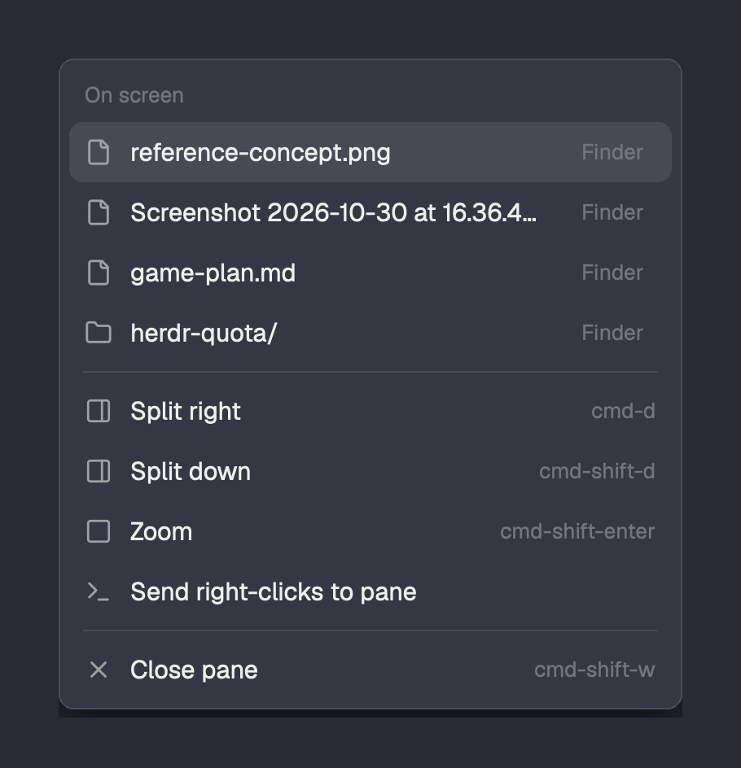

# Path menu for Herdr

Right-click a terminal in [Herdr](https://herdr.dev) and open the files and folders on screen.
When an agent tells you "I saved the screenshot to `art/shots/bat.png`", right-click, click the
name, and it opens in Preview. Folders open in Finder; **Finder** beside a name shows it in its
folder.



- Finds absolute paths, `~/` paths, paths relative to the terminal's folder, names with spaces
  (`Screenshot 2026-10-30 at 16.36.42.png`), paths that wrapped onto the next line, and
  editor suffixes (`main.ts:12:3`, `notes.md#L4`).
- Finds bare file names too: `reference-concept.png` that is not in the terminal's folder is
  looked up in the project below it (git's file list, or a bounded `find`), two matches at most.
- Lists only paths that exist, newest (lowest on screen) first, at most six.
- Keeps Herdr's own terminal menu items (Split, Zoom, Close) below them.
- macOS opens with `open`, Linux with `xdg-open`, Windows with `explorer`.

## Install

Ask the agent running in Herdr: "add the Herdr mod at github.com/Lakris2407/herdr-mods/tree/main/path-menu". Or by hand,
after the [one-time setup](../README.md#one-time-setup):

1. Copy `mods/path-menu` to `~/.config/herdr-app/mods/path-menu` and run
   `herdr-app check ~/.config/herdr-app/mods/path-menu`.
2. Set the root field of `~/.config/herdr-app/layouts/main-plus.json`:

   ```json
   "terminal_menu": "path-menu"
   ```

## How it works

Herdr tells a terminal menu which terminal was clicked, not which word, so the menu reads that
terminal's screen (`hc read`), collects path-like words (and up to six words after each, for
names with spaces), and asks the shell which of them exist. It opens at once with Herdr's
items, then reopens in place, sized for the paths it found. Only terminals on this computer are
scanned. It reads no history above the screen and sends nothing anywhere.

Clicking a name opens it with its default app: an `.app` path starts that app.

## Credits and license

`mods/path-menu/main.js` is a modified copy of the `menu` mod shipped with the
[Herdr desktop app](https://github.com/herdrdev/herdr-app) (Apache-2.0, copyright the Herdr
authors). Changes: the on-screen paths section, the reveal button, opening files, and reopening
the popup at the right size. `paths.js` is new. The icons it draws are Herdr's own
(`mods/files`, `mods/workspace-chrome`) and are not included here.

Licensed under the [Apache License 2.0](LICENSE), the same as Herdr.
