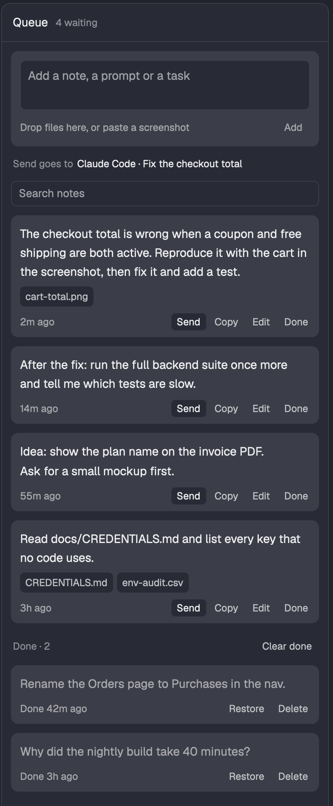

# Queue in Herdr

A side panel for the [Herdr](https://herdr.dev) desktop app that holds the prompts you are not ready
to send yet. Write a note while an agent works, attach files or a screenshot, and send it with one
click when the agent is free. An answer for later, an idea to come back to, the next three prompts:
they wait here instead of in your head.



The screenshot uses made-up notes.

## How it works

- **Write.** Type in the field at the top and press **Add** (Cmd+Enter in the field; Ctrl+Enter on
  Linux and Windows). Enter makes a new line. A draft you have not added yet survives a restart.
  Add clears it only after the note is saved; a failed save keeps the draft and attachments.
- **Attach.** Drop files anywhere on the panel, or paste in the field: a screenshot on the clipboard
  becomes an image under the note, and a file copied in Finder is attached as itself. A dropped
  file is not copied: the note keeps its path. A pasted image is saved in
  `~/.config/herdr-app/queue-files/` and shows as a thumbnail. Click the thumbnail to see
  the image large over the window; Escape or a click closes it. Pasting needs macOS (it reads the
  clipboard with `osascript`); dropping works everywhere.
- **Send.** Pastes the note into an agent's terminal and presses Enter, then marks the note done.
  The agent gets the text, then each file's path on its own line, so it can open a screenshot itself.
  If you are typing in that terminal, Herdr waits until your draft is gone before it pastes.
  If a send fails, the reason stays on the note until you send again or dismiss it.
- **Where Send goes** is always written under the field ("Sends to [icon] Fix the
  checkout total · free"): the icon of the agent's program (Claude, Codex), the agent's own title,
  and what it does now. A program with no icon gets a ring when it is free and a dot when it works
  or waits for your answer. It is the agent whose terminal you used last, or the only agent
  in the shown tab. Send never goes to a plain shell, where the text would run as a command, and it
  never picks between two agents for you: click the one you mean, or press **Change** and pick it
  from the list, then send. A pick holds while you stay in the panel. If the agent is in a tab you
  do not see, the line says which tab.
- **Copy** puts the same text on the clipboard, for a chat outside Herdr, and marks the note done.
- **Edit** moves the note back into the field; **Save** or **Cancel** ends the edit. A draft you
  had in the field is set aside and comes back after. If another window deleted the original while
  you edited it, Save keeps your edit as a new note.
- **Done** notes move to a list at the bottom. **Restore** puts one back in the queue, **Delete**
  removes it, and **Clear done** removes all of them (under a search: the ones the search shows).
  Only a done note can be deleted, and **Undo** shows for about ten seconds after a delete, so one
  wrong click never loses a note. Deleting a note deletes its pasted images too, once Undo is gone;
  files you dropped are never touched.
- **Search** shows above the list once it holds six notes. Every word you type must be in the note
  or in one of its file names.
- If a change cannot be saved (another window changed the notes, or the disk refused), the panel
  says so until you dismiss it, and the text you wrote stays in the field.
- A long note shows its first six lines; click the text to see all of it.

## Data

The notes are in `~/.config/herdr-app/queue.json`, as readable JSON: each note has its text, its
files' paths, when you made it and when it was done. Pasted images are beside it in `queue-files/`.
Back the two up together. The mod runs `hc send` (Herdr's own tool) to send a note and `osascript`
to read a pasted image, and sends nothing over the network.

If the file is not valid JSON, the panel says so and saves nothing until you fix or remove it, so
it never writes over notes it could not read. Click **Retry** after repairing the file.

Files on another machine: a note keeps paths on this computer. An agent in a space on another
machine gets the text and the paths, but it cannot open those files there.

`{ "demo": true }` in the queue block's `props` (`"content": { "mod": "queue", "props": { "demo": true } }`)
shows made-up notes and reads, saves and sends nothing. The screenshot above uses it.

## Keyboard

The panel can take the keyboard: move onto it with `pane.go` (your pane-navigation keys) like any
pane. A line at the bottom then shows the keys. ↑ and ↓ move a ring over every button, file and
long note, J and K jump to the next and the previous note, Enter or Space presses the one with the
ring, N puts the cursor in the field, / in the search, ← and → move to the next pane that way, and
Escape goes back toward your terminals. After Send, Done or Delete the ring lands on the button
that takes it back (Restore, Undo), so a second Enter never sends or deletes the next note. In the field, Escape gives the keyboard back
to the panel. `herdr-app do queue.new` puts the cursor in the field from anywhere, so you can bind
a key to it.

## Install

Ask the agent running in Herdr: "add the Herdr mod at github.com/Lakris2407/herdr-mods/tree/main/queue". Or by hand,
after the [one-time setup](../README.md#one-time-setup):

1. Copy `mods/queue` to `~/.config/herdr-app/mods/queue` and run
   `herdr-app check ~/.config/herdr-app/mods/queue`.
2. Add the panel to the side-panel stack (`panel-body`) in `~/.config/herdr-app/layouts/main-plus.json`:

   ```json
   { "id": "queue", "type": "block", "content": { "mod": "queue" } }
   ```

3. Give it a tab-bar button, as in the [one-time setup](../README.md#one-time-setup):
   `panelButton("queue", "Queue", "mods/queue/queue.svg")`.

## Tests

```sh
npm test   # from the repo root
```

`mods/queue/notes.js` holds the queue's logic and has no Herdr imports, so the tests run in plain Node.

## License

MIT, see [LICENSE](../LICENSE).
