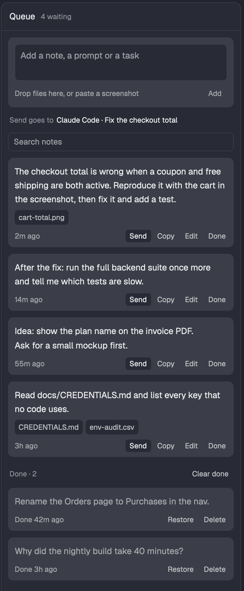

# Queue

A side panel that holds notes and prompts until you send them: a field to write in, the waiting
notes with their files, and the done ones below. Send pastes a note into an agent's terminal and
presses Enter.

## What you see

- **Header** (42 px, 1 px `border` bottom): "Queue" in semibold and one status in 11 px: "4
  waiting", "Sending…", or for four seconds what just happened ("Sent to Claude Code · Fix the
  checkout total" in the ok color, "Not sent" in the fail color). It has the `status` role.
- **Unsaved line:** when a save fails, a wrapping line in the warning color at the top of the list
  with **Dismiss**; it stays until dismissed or until the next save works.
- **Key line:** only while the panel has the keyboard, "↑ ↓ move · J K next note · Enter runs · N
  writes · / searches · Esc leaves" at the bottom in 11 px, so the list does not move.
- **Field** (a `raised` card, 8 px radius): a text area on `background` with a 1 px border at 3:1
  that takes the ring color while you type, growing from 2 to 10 rows. Under it the attached files, then
  one line: a hint at the left ("Drop files here, or paste a screenshot"; while typing "⌘↵ adds ·
  Esc leaves the field"; Ctrl+Enter off macOS) and **Add** at the right, dim while there is nothing to add. While a note
  is edited the card says "Editing a note" (and that the draft comes back, when there was one), the
  note's card gets a ring-colored border, and the buttons read **Cancel** and **Save**.
- **Target line** (11 px, 24 px high): "Sends to" in the hint color, a 7 px status mark (a ring in
  the ok color when the agent is free, a filled dot in the hot color when it works, in the fail
  color when it waits for you), the agent in the text color (its program and its own title), the
  status as a word, and with more than one agent **Change** at the right. The line is then a
  button: it opens a list of every agent (mark, name, tab name and status), and a click picks one.
  An agent in a tab that is not shown adds a line in the warning color: 'This agent is in the tab
  "api", not in the tab you see.' With agents but none chosen: "Choose where Send goes". With no
  agent: "No agent runs yet. Start one, and Send goes to it."
- **Search** (28 px, 1 px border at 3:1, ring color while typed in): only from six notes on, or
  while a search is typed; **Clear** beside it while it holds text.
- **A note** (a `raised` card): the text in 13 px, at most six lines or 420 characters (a click
  shows the rest); its files as 24 px chips on `background` with the file name, the path in the
  tooltip, and a pasted image as a 44 px thumbnail that a click shows large in a dialog (90% of
  the window, the image fitted, at most twice its pixels); then a line with its age at the left and
  **Send** (the one filled button), **Copy**, **Edit** and **Done** at the right in 11 px, 24 px
  high. Send is dim with no agent, and reads "Sending…" while it runs. A failed send writes why on
  the card in the fail color, wrapping, with **Dismiss**, and Send reads **Send again**.
- **Done:** a heading "Done · 2" with **Clear done** at the right ("Clear shown" under a search),
  then the done notes, last done first, their text in the hint color, with "Done 42m ago",
  **Restore** and **Delete**. After a delete, "Deleted 2 notes" and **Undo** show above the heading.
- **Empty states:** "No notes yet. Write a prompt now, and send it when an agent is free. Send
  pastes the note into the agent and presses Enter.", "The queue is empty. The notes below are
  done.", "No note matches the search."
- **Readable colors** (`colors.js`): labels 6:1 and hints 4.5:1 on `raised`, the focus ring 3:1.
- **Type scale:** 11 (status, hints, buttons, chips, key line), 12 (search), 13 (note text, field,
  title).

## How it behaves

- Notes are `{ id, text, files, createdAt, doneAt }` in `queue.json` in Herdr's home, written as
  `{ "version": 1, "notes": [...] }`. A new note goes on top. Changes appear after a successful
  save; mutation buttons wait while a save or reload runs. Each save names the text it expects to replace
  (`writeTextFile`'s third argument), so a change made by another copy is never written over: the
  panel says the change was not saved, keeps the text and attachments in the field, and
  loads the file again. After a save the panel sets shared
  state `queue.rev`, and every other copy loads the file within three seconds.
- A file that is not valid JSON shows an error and blocks every change until it is fixed.
- The draft in the field is kept in `localStorage` (`draft`) until its save succeeds. Edit sets the
  draft aside and puts it back when the edit is saved or cancelled.
- Dropped files (`on_drop` on the root) are kept as paths. A paste with no text (`paste_other`)
  runs `osascript`: the clipboard's PNG is written to `queue-files/<uuid>.png`; without one, the
  clipboard's file reference is used when that path exists. A pasted image is deleted when the last
  note that holds it is deleted and Undo's time is up, and when it leaves the field without having
  been added.
- Send runs `hc send --json -- <terminal> <text>`. The text is the note, a blank line, then one
  path per line. On success the note is marked done; on failure it stays and says why and what
  to do (the agent is gone, the agent waits for an answer, `hc` is missing) until it is sent again
  or dismissed.
- The target is the agent whose terminal last had the keyboard (`focused().terminal`, remembered),
  else the only agent in the shown tab, else none. A shell is never a target. An agent picked from
  the list is the target while the panel has the keyboard; after that the terminal you use wins again.
- A thumbnail's click opens the same mod as a dialog with `props.viewer` (`{ picture, size }`): it
  draws only the image, fitted to the dialog (`sips` reads the pixel size on macOS), and a click
  or Escape closes it.
- Copy writes the same text to the clipboard and marks the note done.
- Only done notes can be deleted. Delete and Clear done keep the notes for eight seconds (the timer
  ends it, so up to three more): Undo puts each one back at its old place. Under a search, Clear
  deletes only the done notes the search shows.
- `"focusable": true`: `pane.go` gives the panel the keyboard. Every button registers in reading
  order while the panel renders, with a role and a screen-reader label: the buttons, each file's ×,
  each thumbnail, each long note's text and the agents in the list. ↑/↓ move a 2 px ring, J/K jump
  to the first control of the next or the previous block (the field, the target, a note), Enter
  or Space presses, N focuses the field, / the search, ← and → run `pane.go` that way, Escape runs `pane.go`
  toward the terminals, and Escape in a text field gives the keyboard back to the panel.
  `queue.new` (`herdr-app do queue.new`) focuses the field. The ring is kept as the id of its
  control, and an action that moves its own button puts the ring on the one that takes it back
  (Send, Copy and Done on Restore, Restore on Done, Delete on Undo).
- A three-second timer does the reload after another copy's save, clears the status after four
  seconds, ends Undo and keeps the ages true; it redraws only for those.

## Built from

- One mod, `mods/queue`, `mod.json` `{ "place": "none", "title": "Queue", "focusable": true }`, shown as a
  block in the side panel stack (`panel-body`) of a cloned layout, with a button in a cloned tab bar.
- `herdr` API: `hc` (`hc send`), `exec` (`osascript`, `sips`), `openOverlay` / `closeOverlay`, `settings`, `window`, `readTextFile` / `writeTextFile`, `appHome`,
  `agents`, `focused`, `layout`, `run` (`pane.go`), `theme`, `shared` / `setShared`, `nextCommand`;
  `fs/promises` (`mkdir`, `unlink`, `exists`); `TextareaState` + `Textarea`, `InputState` + `Input`,
  `image`, `.on_drop`, `cx.write_to_clipboard`.
- `notes.js` is pure (no `herdr` imports), so `node --test` covers the queue's logic. `store.js`
  reads and writes; `place.js` finds the side Escape leaves to and fits the large image; `demo.js`
  has the made-up notes.

## Watch out

- `hc send` presses Enter. Never send to a terminal that is not an agent.
- Put `--` before the terminal and the text, or a note that starts with a dash is read as an option.
- AppleScript turns clipboard text into a file reference without complaint; use the reference only
  when that path exists.
- A text area takes its own presses: stop the mouse-down on its wrapper, and track its `focus` and
  `blur` so the panel's own keys (N, Enter, the arrows) do nothing while you type.
- `image()` takes a path inside Herdr's home, which is why only pasted images get a thumbnail.

## Done when

- `herdr-app check mods/queue` passes and `node --test` passes.
- A note you add is in `queue.json` and is still there after Herdr restarts.
- With an agent's terminal clicked, Send puts the note and its files' paths into that agent and the
  note moves to Done; with only a shell in the tab, Send is dim.
- A screenshot pasted in the field shows as a thumbnail, and its file is gone from `queue-files/`
  after its note is deleted.
- The keyboard reaches every button, file and long note in reading order.
- Delete then Undo puts the note back; a failed send stays written on its note.
