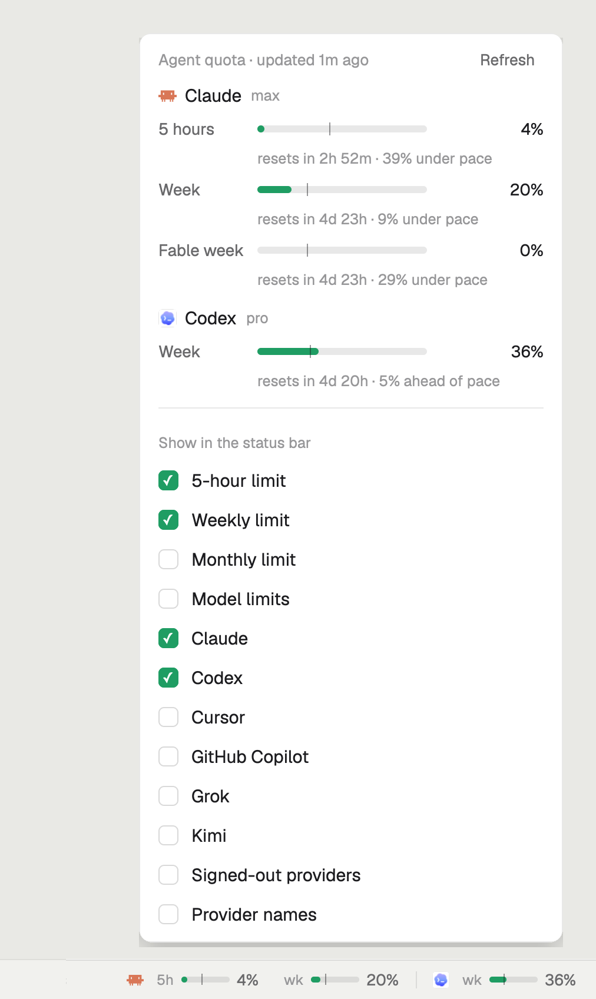

# Agent quota and system load for Herdr

Your coding agents' usage limits in the [Herdr](https://herdr.dev) status bar: one slim bar per
limit, so Claude's 5-hour and weekly limits show side by side. Quiet until it matters: bars turn
amber at 60%, orange at 80% and red at 92%. Click it for details and options.

Optional second mod: live CPU, RAM and GPU load beside it, so you do not need Activity Monitor
to see what your agents do to your Mac. See [System load](#system-load-optional-second-mod).




- **Every limit at a glance:** Claude 5-hour and weekly, Codex weekly, and any other provider
  [`quota-axi`](https://github.com/kunchenguid/quota-axi) knows (Cursor, GitHub Copilot, Grok, Kimi).
- **Pace:** a thin tick on each bar marks how much of the window has passed. A small ▲ means you
  are using it faster than the clock.
- **Popup:** reset times, "ahead of pace" or "under pace", and options for what the bar shows:
  5-hour, weekly, monthly and per-model limits, each provider, signed-out providers, names.
- Follows your Herdr theme, light and dark.

## Requirements

- The Herdr desktop app (`herdr-app`).
- [`quota-axi`](https://github.com/kunchenguid/quota-axi) by
  [kunchenguid](https://github.com/kunchenguid), which reads the quota:

  ```sh
  npm install -g quota-axi
  quota-axi            # check that it sees your providers
  ```

## Install

Ask the agent running in Herdr: "add the Herdr mod at github.com/Lakris2407/herdr-mods/tree/main/quota". Or by hand,
after the [one-time setup](../README.md#one-time-setup):

1. Copy `mods/quota` to `~/.config/herdr-app/mods/quota` and run
   `herdr-app check ~/.config/herdr-app/mods/quota`.
2. Add the block to the status row in `~/.config/herdr-app/layouts/main-plus.json`:

   ```json
   { "id": "status-quota", "type": "block", "content": { "mod": "quota" }, "size": { "weight": 2.4 }, "min": 130 }
   ```

   On a narrow window the quota draws shorter bars, then drops the bars, then the window labels, so
   every provider stays visible and "5h 25%" keeps saying which limit it is as long as it can.

## Options

Click or right-click the bar to choose what it shows; choices are saved. A layout can set the
starting options with `props`, for example to hide a provider:

```json
"content": { "mod": "quota", "props": { "hidden": ["cursor"] } }
```

`props` takes `hidden` (provider ids), `kinds` (`{ "session": true, "weekly": true, "monthly": true, "model": false }`),
`signedOut`, `names` and `remaining` (default `false`).

Enable **Show remaining instead of used** in the popup to switch the percentages and bar fills
in both views. Colors and pace warnings still reflect usage, so nearly exhausted limits stay red.
Used-share windows stay labeled as used because they are not independent allowances.

Keys: bind `quota:menu` (open the popup) and `quota:refresh` (read now) in `keys.json`.

## What it runs

The mod runs `quota-axi --json` every 2 minutes, and when you click Refresh. If Herdr cannot find
it on its own `PATH` (common when Herdr starts from the Dock), it asks your login shell
(`$SHELL -lic`). Both commands run on the selected space's machine. The mod itself makes no
network requests and stores no tokens; `quota-axi` reads that machine's Claude, Codex and other
CLI sign-ins to ask each provider for your usage. The one exception is OpenRouter, below.

## OpenRouter spend (DeepSeek)

OpenRouter is pay as you go, so it shows dollars, not a percentage: a baby-blue whale, the short
model name and what you spent today (`v4.1-flash $1.42 today`). The popup adds this week, this
month and the credit left, and lets you pick which period the status bar shows. The amount turns
orange, then red, when less than 20% and 8% of your credit is left.

- **Spend** comes from `https://openrouter.ai/api/v1/key` (`usage_daily`, `usage_weekly`,
  `usage_monthly`). **Credit left** comes from `/api/v1/credits`, or from the key's own limit
  when the key cannot read credits.
- **Model** is the `model:` line in `~/.dsh/profiles/headless/cordis.patch.yml`, the profile
  DeepSeek Harness (`dsh-worker`) uses.
- It reads this computer only, on the same 2-minute timer. Spend is per account, not per machine.

Save the key once in the macOS Keychain. The command asks for the key, so it stays out of your
shell history:

```sh
security add-generic-password -U -a "$USER" -s openrouter-api-key -w
```

Without that entry the mod tries `OPENROUTER_API_KEY` from Herdr's environment. Without either,
OpenRouter does not show (turn on **Signed-out providers** to see it as not signed in). The key
goes from the Keychain to `curl` through a pipe inside one fixed `sh` script
(`quota/mods/quota/openrouter.js`). It is never a command argument, and it never reaches the mod,
Herdr's shared state, the repository or a log. Only the dollar amounts and the model name do.

## Remote machines

The status bar follows the selected space's machine. Install `quota-axi` on each remote machine
(`npm install -g quota-axi`) and sign into your providers there. Credentials stay on that machine.
The popup identifies the machine and stays on it until closed, including when you click Refresh.

Results and errors are cached separately per machine. Switching machines fetches immediately;
an unreachable remote or missing dependency shows an error instead of using your local account.
Options are shared across machines. Sessions using a custom `CODEX_HOME` are not detected:
the report uses the CLI environment of the machine's Herdr core.

## System load (optional second mod)

`mods/system` shows CPU, memory and GPU load next to the quota: a small live graph of the last
36 seconds and the percent for each, in the same green, amber, orange and red scale. Hover for
details (user and system CPU, GB of memory used); click to open Activity Monitor on this Mac.

Like the quota, it follows the selected space's machine: a remote space shows that machine's
load, with its name in front. Switching machines reads at once and starts the graphs over; an
unreachable machine shows "System load unavailable", never this computer's load. If a machine
stops answering, its last numbers stay dimmed, with the error and their age in the tooltip, and
after a minute they give way to "System load unavailable". Nothing needs installing on the
remote. One `sh` call every 3 seconds picks the branch by `uname`; none need root.

- **macOS** reads `iostat`, `vm_stat`, `sysctl` and `ioreg`. Memory is Activity Monitor's
  "Memory Used" (app memory, wired and compressed).
- **Linux** reads `/proc/stat`, `/proc/meminfo` and, with an NVIDIA GPU, `nvidia-smi`. Inside a
  container (a Coder or Kubernetes workspace, Docker) it reads the cgroup v2 files instead, so
  the numbers are the container's own: CPU against its `cpu.max` quota, and memory as the working
  set (usage minus reclaimable file cache, as `kubectl top` counts it) against `memory.max`.
  The tooltip says "container limit" when one applies.
- **Windows** (only this computer, when Herdr itself runs on Windows) reads one PowerShell call:
  `Get-Counter` for CPU and the 3D GPU engines, `Win32_OperatingSystem` for memory. Remote
  machines still get the `sh` script above. The counter names are English, so a Windows install
  in another language can show "no CPU reading".

Install: copy `mods/system` to `~/.config/herdr-app/mods/system` and add a block before
`status-quota` in the status row:

```json
{ "id": "status-system", "type": "block", "content": { "mod": "system" }, "size": { "weight": 2.0 }, "min": 120 }
```

On a narrow status bar it drops the graphs, then the GPU, so CPU and RAM always show. The numbers
stay quiet until a metric is at 80% or more for about 30 s, then turn orange; load is never red, because
with several agents at work a busy machine is normal.

## Antigravity limits

The provider list includes an **Antigravity: Claude/GPT limits** option.
Turn it off to hide its Claude/GPT session and weekly windows in the strip and popup
without hiding Gemini. This does not affect the standalone Claude provider.
The choice is saved; it defaults to enabled so existing installations keep their display.
Layouts may also set `agyClaudeGpt: false` in quota props as the initial preference.

## Windows

Install Node.js and `quota-axi` (`npm install -g quota-axi`) and ensure the npm global
bin directory is on the environment PATH available to Herdr. If the native executable
cannot start, the quota mod tries the Windows npm shim through `cmd.exe /d /s /c`.
No Git Bash or hard-coded Node installation path is required.

Run `quota-axi --json` in a terminal to check your provider sign-ins. Then run
`herdr-app check ~/.config/herdr-app/mods/quota`. The optional system-load mod
reads this Windows computer through PowerShell (see above), and macOS and Linux machines through `sh`.

## Credits

- Quota data: [quota-axi](https://github.com/kunchenguid/quota-axi) by kunchenguid (MIT).
- Provider icons: the ones Herdr ships in `~/.config/herdr-app/icons`; this repo includes none.
- Built on the [Herdr](https://github.com/herdrdev/herdr-app) mod API.

## License

MIT, see [LICENSE](../LICENSE).
