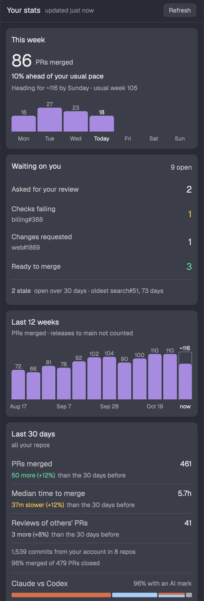

# Your stats in Herdr

A side panel for the [Herdr](https://herdr.dev) desktop app with your own delivery numbers across
every repo you open PRs in. It leads with this week: PRs merged, your pace against a usual week, and
each day. Then what waits on you: reviews you were asked for, your PRs with failing checks, with
changes requested or ready to merge, and the stale ones, each a click away. Then the last 12 weeks,
and the last 30 days: PRs merged, median time to merge, reviews of other people's PRs, commits,
merge rate, and Claude against Codex by PRs and time to merge. Last, PRs per repo; a repo opens
your PRs there.



The screenshot uses made-up data.

## How it counts

- **PRs** are yours when you opened them, in any repo. Releases (`develop` → `main`) are left out,
  because their work was already counted when it merged into `develop`. Hotfixes into `main` count.
  A PR you opened months ago and merged this week counts this week.
- **AI share** looks at the PRs merged in the last 30 days:
  - Claude: a `Co-Authored-By: Claude` commit trailer, "Generated with Claude Code" in the PR text,
    or a `claude/` branch.
  - Codex: a `Co-Authored-By: Codex` trailer, "Generated with Codex" in the PR text, or a `codex/`
    branch. A plain mention of Codex in the PR text does not count, because it usually describes a
    Codex review.
  - A PR with marks from both counts as Both. The percentage rounds down.
  - Next to each one's PR count, its median time to merge, so you can compare the two on more than
    volume.
- **Commits** are commits linked to your account (your agents' commits count, when they commit as you) in each repo you merged into during the last 30
  days (and this week, shown under the week's PR count), on the repo's default branch (or the branch you set in `workBranch`, below).
- **Reviews** are other people's PRs you commented on (Codex and Claude reviews that post through
  your account count too), bucketed by when the PR was opened.
- **Merge rate** is merged ÷ (merged + closed without merging) over the last 30 days.
- **Pace** compares this week with your usual week at the same point: on a Thursday, with the Monday
  to Thursday of the last four full weeks (the median), not with whole weeks. Within 10% reads "On
  your usual pace". The panel shows "N% ahead of" or "N% behind your usual pace" and a "heading for
  ~N by Sunday" estimate only once a usual week has at least 3 merges by this point, so Monday
  morning shows your usual week instead. Pace is a fact, not a judgment, so it is never red.
- **Comparisons** say the change in words and as a percentage, against the 30 days before: "276
  more (+53%)", "16m slower (+23%)", "9 fewer (−20%)". More PRs and a faster merge are green, fewer
  PRs and a slower merge red, but only past 10%: a smaller change stays neutral, because PR counts
  and merge times are noisy. Reviews stay neutral, because fewer reviews is not worse in itself.
- **Waiting on you** has up to four rows, each hidden at zero:
  - Asked for your review: other people's open PRs that still request your review.
  - Checks failing: your open PRs whose last commit's checks fail.
  - Changes requested: your open PRs a reviewer sent back.
  - Ready to merge: your open PRs that are not drafts, whose checks pass and that no review blocks.

  A row with one PR names it and opens it. A row with more opens the same search on GitHub. GitHub
  searches as the account your browser is signed in to, so with several accounts in `logins` a list
  can differ from the count. Under them, PRs open more than 30 days are **stale**, with the oldest
  named; the line opens them oldest first.
- Weeks start on Monday in your local time.

## Settings

With no settings, the panel counts the account `gh` is logged in as. To count more accounts, or to
count commits on a branch other than the default, create `~/.config/herdr-app/stats.json`:

```json
{
  "logins": ["your-login", "your-work-login"],
  "workBranch": { "your-org/your-repo": "develop" }
}
```

`{ "demo": true }` in the stats block's `props` (`"content": { "mod": "stats", "props": { "demo": true } }`)
shows made-up numbers and runs nothing. The screenshot above uses it.

## Data and speed

Everything comes from `gh api graphql`, so [`gh`](https://cli.github.com) must be logged in
(`gh auth login`). A full load takes about 15 seconds: 13 weekly searches per account (search
returns at most 1,000 rows) and one for older PRs that closed in that time, PR texts only for the
last 30 days, one query for open PRs, review requests and review counts, and one for commit counts.
Only the computed numbers are kept, in Herdr's shared state (`stats.v4`), for 30 minutes, so the
panel opens at once. **Refresh** reloads now, and `herdr-app do stats.refresh` does the same from a
terminal. When a reload fails, the header says "Couldn't refresh · numbers from 47m ago" and the
last numbers stay readable. The mod sends nothing anywhere except your own `gh` queries to GitHub,
and opens `https://github.com/` pages in your browser when you click a PR or a repo.

## Keyboard

The panel can take the keyboard: move onto it with `pane.go` (your pane-navigation keys) like any
pane. A line under the header then shows the keys. ↑ and ↓ move between Refresh, the "Waiting on
you" rows, the repos and "Show more repos", Enter or Space opens the one with the ring, R
refreshes, ← and → move to the next pane that way, and Escape goes back toward your terminals. Each
item has a label for screen readers, and each chart reads as one sentence.

The panel cannot scroll itself to follow the ring yet, so the ring can move below the fold. Scroll
with the wheel or trackpad to see it.

## Install

Ask the agent running in Herdr: "add the Herdr mod at github.com/Lakris2407/herdr-mods/tree/main/stats". Or by hand,
after the [one-time setup](../README.md#one-time-setup):

1. Copy `mods/stats` to `~/.config/herdr-app/mods/stats` and run
   `herdr-app check ~/.config/herdr-app/mods/stats`.
2. Add the panel to the side-panel stack (`panel-body`) in `~/.config/herdr-app/layouts/main-plus.json`:

   ```json
   { "id": "stats", "type": "block", "content": { "mod": "stats" } }
   ```

3. Give it a tab-bar button, as in the [one-time setup](../README.md#one-time-setup):
   `panelButton("stats", "Stats", "mods/stats/stats.svg")`.

## Tests

```sh
npm test   # from the repo root
```

`mods/stats/stats.js` holds all the counting and has no Herdr imports, so the tests run in plain Node.

## License

MIT, see [LICENSE](../LICENSE).
