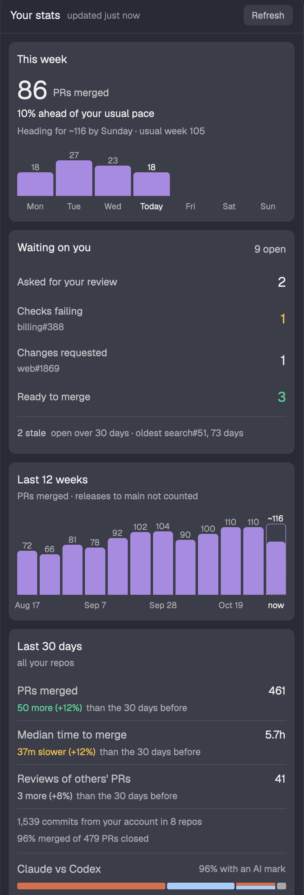

# Your stats

A side panel with your own delivery numbers across every GitHub repo you open PRs in: PRs merged
per week and per day, median time to merge, open PRs, how many of your merged PRs were made with
Claude or Codex, PRs and commits per repo, reviews of other people's PRs, and merge rate.

## What you see

- **Header** (42 px, 1 px `border` bottom): "Your stats" in semibold, one status ("updated 4m ago",
  "Refreshing…", or "Couldn't refresh · numbers from 47m ago" in the warning color), and a bordered
  Refresh button (11 px, `hover` background), as in the runners panel.
- **Readable colors** (`colors.js`): each theme color is lifted toward the foreground only when a
  theme sets it below its floor on `raised`. Labels 6:1; hints, good (`ansi2`), bad (`ansi1`) and
  warning (`ansi3`) 4.5:1; bars, the AI colors and the focus ring 3:1, the floor for non-text marks.
- **This week** (full width, `raised`, 8 px radius): "This week" with "N commits" at the right, the
  count at 30 px with "PRs merged", the pace in words ("15% behind your usual pace", "On your usual
  pace"), then "Heading for ~150 by Sunday · usual week 176" in the hint color, then Monday to
  Sunday as bars with every value. Today's bar is lighter; future days draw nothing. The pace's
  tooltip names the usual week, the usual count by now and last week.
- **Open PRs:** the count at the right of the title, then "Oldest gavematch#3 open 181 days" as one
  clickable row; "open N days" turns to the warning color at 14 days. "None open" when there are none.
- **Last 12 weeks:** 12 bars in `accent`, this week lighter and labelled "now", every value above
  its bar (1.2k past 999). This week's bar sits in a dashed outline up to where the week is heading,
  and its label names that estimate ("~150").
- **Last 30 days:** rows with the label and value on one line and the comparison under it: PRs
  merged, median time to merge, reviews of others' PRs, your commits ("in 14 repos"), merge rate
  ("of 831 PRs closed or merged"). Comparisons are words in the verdict color ("276 more",
  "16m slower"), then "than the 30 days before" in the hint color; reviews stay neutral. Then "Made
  with AI" with its percent (rounded down), one split bar with 2 px gaps (Claude `#d4704f`, Codex
  `#3f86e0`, Both as the two colors half and half, No AI mark in the hint color) and a legend with
  counts, so color is never the only label.
- **By repo:** the top five repos by merged PRs, one bar each, commits on hover; each row opens your
  PRs in that repo. "Show 9 more repos · 33 PRs" expands the list and "Show fewer repos" folds it.
  The owner shows only when two listed repos share a name.
- **Type scale:** 10 (chart labels), 11 (secondary), 12 (pace, repo names), 13 (body and card
  titles), 30 (this week's count). Numbers group thousands by hand, because the runtime's
  `toLocaleString` does not.

## How it behaves

- Loads on open when the cached numbers are older than 30 minutes, checks every 5 minutes, and
  reloads on Refresh, R, or the `stats:refresh` key command (`herdr-app do stats.refresh`).
- Only the computed numbers go into shared state `stats.v3` (`{ at, stats }`), no PR texts.
- Errors show as a sentence that says what to do (`plainError` in `stats.js`): how to install `gh`,
  "Run gh auth login in a terminal, then refresh", the API limit, or no network. With numbers on
  screen they show in the warning color and the numbers stay at full opacity.
- `"focusable": true`: `pane.go` gives the panel the keyboard. Every clickable thing registers in
  reading order while the panel renders; ↑/↓ move a 1 px accent ring, Enter or Space activates, R
  refreshes, Escape or ← runs `pane.go` left. Clicks open `https://github.com/` pages with `open`.

## Built from

- One mod, `mods/stats`, `mod.json` `{ "place": "none", "title": "Your stats", "focusable": true }`, shown as a
  block in the side panel stack (`panel-body`) of a cloned layout, with a button in a cloned tab bar.
- `herdr` API: `exec` (`gh api graphql`, `open`), `run` (`pane.go`), `readTextFile` and `appHome` (optional `stats.json`),
  `theme`, `shared` / `setShared`, `nextCommand`; elements `.tooltip`, `overflow_y_scrollbar`.
- `stats.js` is pure (no `herdr` imports), so `node --test` covers the counting.
- GitHub: per account, 13 weekly `search(type: ISSUE)` windows of `is:pr author:<login>` (search
  caps at 1,000 rows), with `body` and the last 15 commit messages only for the last 31 days; one
  aliased query for review counts and open PRs; one aliased query for commit counts per repo with
  `history(since, author: { id })`.

## Watch out

- An app started from the Dock can miss Homebrew on `PATH`: fall back to `/opt/homebrew/bin/gh`.
- Search windows overlap by a day; deduplicate by `repo#number` and keep the copy with AI marks.
- PR numbers repeat across repos, so never key by number alone.
- "Codex" in a PR body usually describes a Codex review: count only its "Generated with" line.

## Done when

- `herdr-app check mods/stats` passes and `node --test` passes.
- With `gh` logged in, the panel fills in within about 15 seconds and shows the same 30-day merged
  count as a GitHub search for `is:pr is:merged author:<you> merged:>=<30 days ago>` minus releases.
- Refresh shows "Refreshing…" in the header and then "updated just now".
- On a Thursday the week reads "On your usual pace" or "N% ahead of" / "behind your usual pace",
  never a raw drop against a whole week, and never in red.
- The oldest PR and every repo row open on GitHub, and the keyboard reaches each of them.
